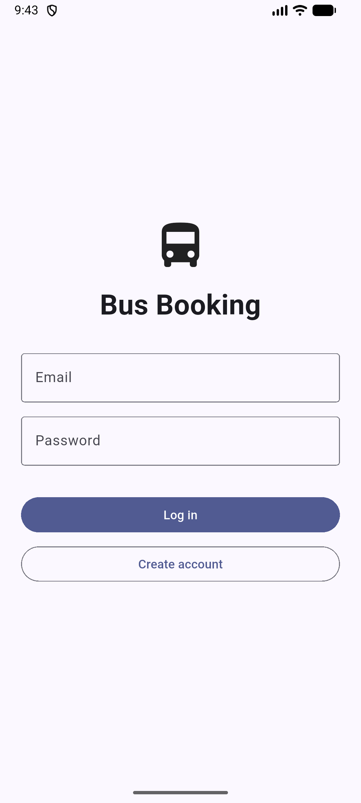
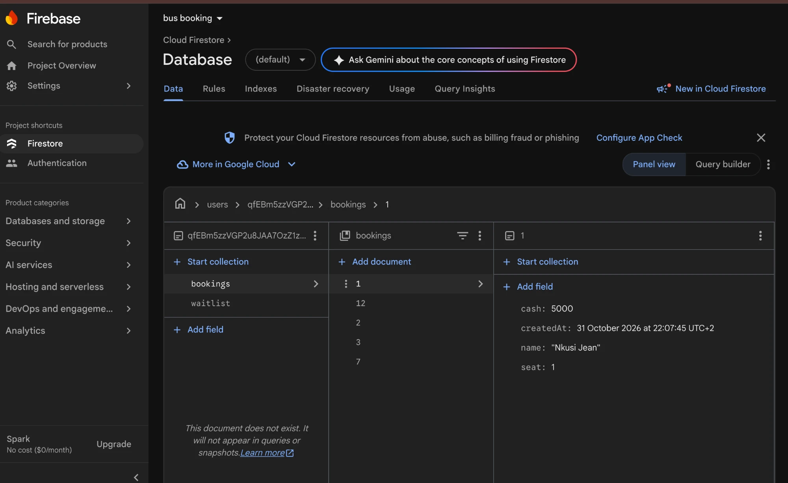
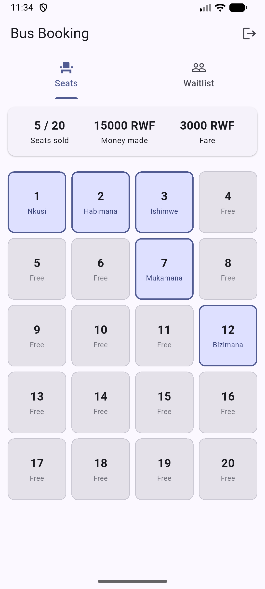
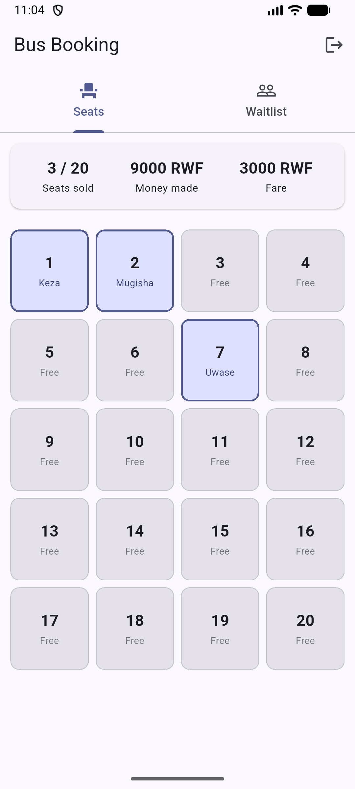

# Bus Booking

A Flutter app for the conductor of a 20-seat bus. It signs users in with Firebase
Authentication, and each user's data is saved in Cloud Firestore under their own id, so two
accounts never see each other's data, and every change appears live.

## What it does

Twenty seats in a grid. Tap a free seat to sell it, tap a sold one to correct the name or
the cash, long press to cancel the booking. A second tab keeps a waitlist of passengers
who could not get a seat, with priority marks.

## How the data is kept

Two collections under `users/{uid}/`:

- `bookings` — seat, name, cash. The seat number is the document id, which is what makes it
  impossible to sell the same seat twice.
- `waitlist` — name, priority, joinedAt.

Only the facts the conductor typed or chose are saved. Seats sold, money made and the
change broken into notes are worked out from that data every time it arrives, so they can
never disagree with it.

## Privacy

`firestore.rules` allows a read or write only when somebody is signed in and their user id
matches the one in the path:

```
allow read, write: if request.auth != null && request.auth.uid == userId;
```

A new account starts with its own sample bookings, written once when it is created.
A second account therefore sees its own bus, never the first account's: different
passengers, different seats, different takings.

## Running it

```bash
flutter pub get
flutter run
```

### Firebase setup

`android/app/google-services.json` is deliberately **not** in this repository, so you need
your own Firebase project to run it:

1. Create a project at `console.firebase.google.com`, Analytics off.
2. Add an Android app with the package name `com.example.bus_booking`, download
   `google-services.json`, and put it in `android/app/`.
3. Authentication: enable the Email/Password provider.
4. Firestore Database: create it in **production mode**, then paste `firestore.rules`
   into the Rules tab and publish.

## Screenshots



The login screen, carrying the app's own name. Both fields are validated before anything is
sent, and Firebase's error codes are turned into sentences a person can read.



The `bookings` collection in the Firestore console, under `users/{my uid}/`. Five documents,
each named after the seat it belongs to, with the fields of seat 1 open beside them.



Seat 12 was written straight into Firestore from outside the app. It appeared in the running
app by itself, with no restart and nothing tapped, and the totals moved to five seats sold
and 15000 RWF.



A second account signed in on the same emulator. It shows three seats and 9000 RWF, its own
sample data, and shares no passenger name with the account above.
